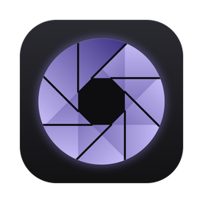
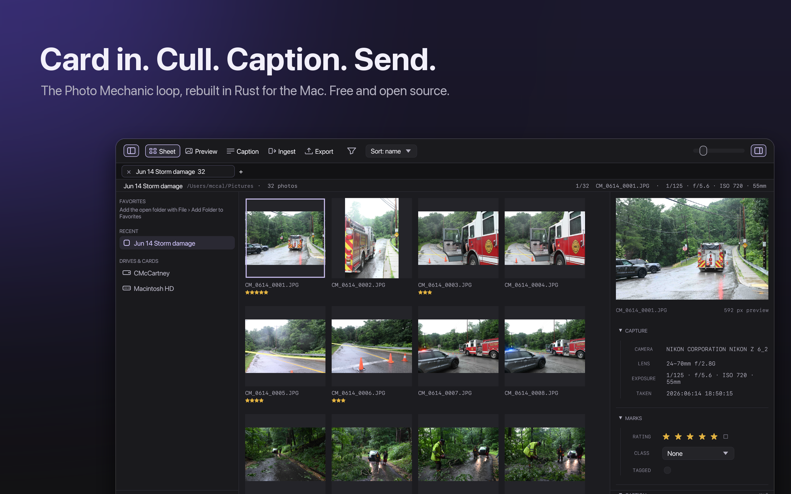
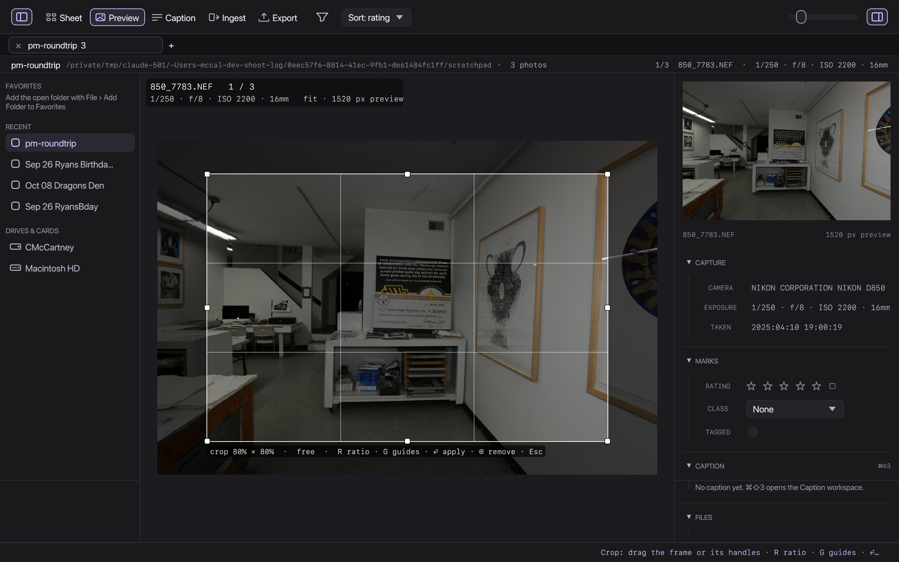
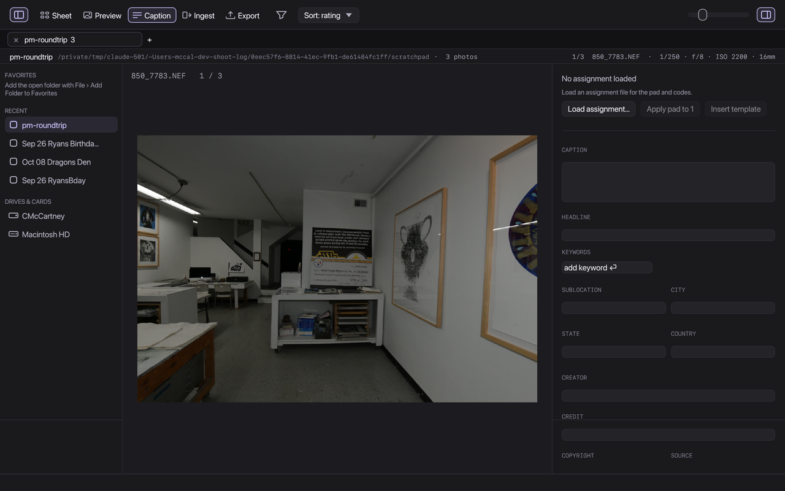
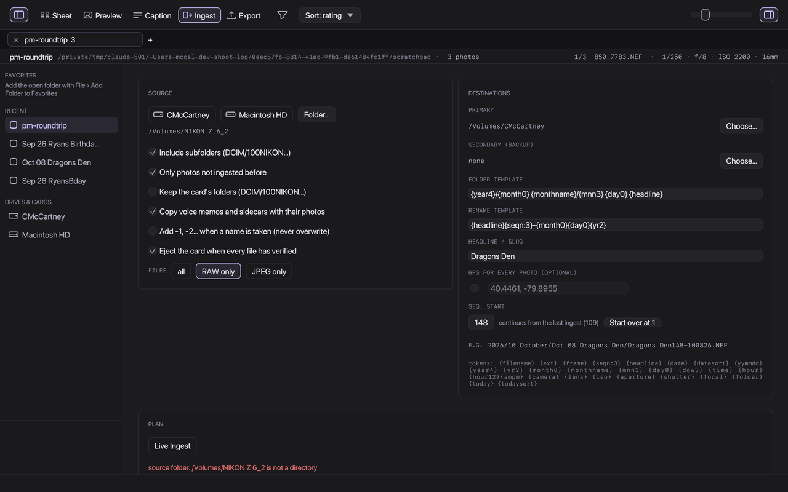
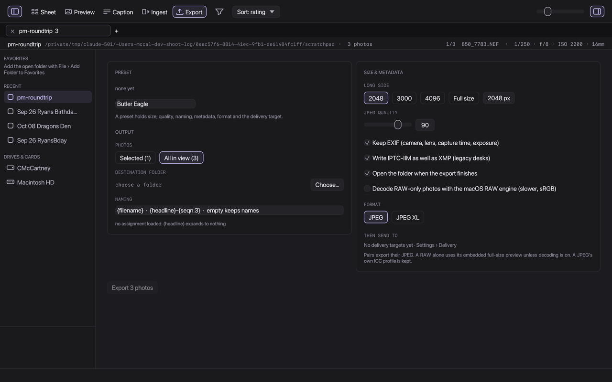

<p align="center">
  
</p>

<h1 align="center">Apature</h1>

<p align="center">
  <b>Apature: a keyboard-first contact sheet, culling, captions and delivery for photojournalists</b><br>
  the Photo Mechanic loop, rebuilt in Rust for the Mac, free and open source.
</p>

<p align="center">
  <a href="https://github.com/McCal-Codes/apature/releases/latest"></a>
  <a href="https://github.com/McCal-Codes/apature/actions/workflows/ci.yml"></a>
  <a href="LICENSE-MIT"></a>
  
  
  
  
  
  <a href="https://ko-fi.com/mccal"></a>
</p>

<p align="center">
  
</p>

<div align="center">

| Version | Price | Platforms | Camera files | Tested on |
| :---: | :---: | :---: | :---: | :---: |
| 0.1.0 | Free | macOS 12+, Linux, Windows 10+ | NEF, RAW+JPEG pairs, JPEG | Nikon Z 6 II, M1 Pro |

</div>

> **Status:** 0.1.0, the first shareable build. It runs my own assignments end to end, but it is early: expect rough
> edges, and tell me about them. Developed on a Mac with a Nikon Z 6 II. See what's changed in [CHANGELOG.md](CHANGELOG.md).

**Contents:** [Why I made this](#why-i-made-this) · [Screenshots](#screenshots) · [What it does](#what-it-does) ·
[What you need](#what-you-need) · [Install](#install) · [Keys](#keys) · [Promises](#promises) · [Get involved](#get-involved) ·
[Artists wanted](#artists-and-animators-wanted) · [Contact](#contact) · [License](#license)

## Why I made this

Honestly, I made this to see what I could do. I love Photo Mechanic and I use it on deadline, but I was curious what
I could build myself, so I rebuilt the loop I actually use every week: card in, cull, caption, export, send. Along
the way I added a few things it doesn't have, like hashed verification of every copy, day chips before you ingest,
and delivery with a sent ledger, and I kept the things it gets right, like the keys and the variables.

Where I want this to go is onboarding. Getting into photojournalism shouldn't mean a cold start with software that
assumes you already know the workflow. I plan for Apature to teach the loop as you use it, the same loop you would
run in Photo Mechanic, so that someone picking it up for the first time can learn the job and the tool together. I
don't like gatekeeping. I'd like the people already in the industry to see this as an effort to bring more people
in, and to show that it isn't that hard. Sometimes it's the software and the experience, not the person.

Who knows where it goes from here. This is the first version, I'm still learning Rust, and it shows in places. Don't
go crazy about it; tell me what breaks and what you'd want next.

## Screenshots

| Preview with the crop tool | Caption workspace |
| :---: | :---: |
|  |  |

| Ingest from a card | Export and delivery |
| :---: | :---: |
|  |  |

## What it does

- **Ingest** from a card or any folder: day chips before you copy, a live example of every name the templates produce,
  SHA-256 verification of every copy at every destination, a ledger so a card is never copied twice, voice-memo and
  sidecar companions, a backup destination, eject when verified, and Live Ingest for a watched folder.
- **Cull** on the sheet: ratings, colour classes, tags, filters, sort, tabs, burst stacks, compare up to four frames, a
  loupe, 1:1 with one shared magnification, a view-only exposure boost, rotate and crop stored in the sidecar.
- **Caption** with an assignment pad, code replacements, Photo Mechanic's variables, keywords, GPS, recent values and
  save-to-selection.
- **Export** JPEG or JPEG XL with presets per outlet, EXIF, XMP and IPTC-IIM kept, then **deliver** to a folder, FTP,
  FTPS or SFTP with passwords in the Keychain, retry, and a per-photo sent ledger.
- Two appearances, Reduce Motion, text scaling, higher contrast, focus rings, a menu bar extra with live status.

## What you need

- A Mac on macOS 12 or newer (Apple silicon is what it is tested on), a Linux desktop with GTK 3 (x86_64, Ubuntu 22.04
  or newer, or anything with a glibc from 2022), or Windows 10 or newer (x86_64). The Mac build is the one I use every
  week; Linux and Windows are built and smoke-tested in CI and are early.
- Photos from a camera that embeds a JPEG preview in its RAW files, which is every current body. Apature never
  decodes a RAW to show a thumbnail when the camera already did the work.
- Optional: `brew install jpeg-xl` for JPEG XL export. Nothing else.

## Install

**macOS.** Download the DMG from the [latest release](https://github.com/McCal-Codes/apature/releases/latest) and drag
Apature to Applications. 0.1.0 is not yet notarised: the first time, right-click the app and choose Open, or allow it
under System Settings › Privacy & Security.

**Linux.** Debian and Ubuntu: `sudo apt install ./apature_*.deb`. Anything else: download the AppImage, mark it
executable and run it (`chmod +x Apature-*.AppImage && ./Apature-*.AppImage`), or unpack the tar.gz and run
`usr/bin/apature`. Passwords for delivery go to the Secret Service keyring (GNOME Keyring
or KWallet); without one, delivery still works but asks for the password each session.

**Windows.** Run the installer (`Apature-*-windows-x86_64-setup.exe`): Start menu entry, optional desktop icon,
uninstaller. Or download the zip, unpack it anywhere and run `apature.exe`. Neither is code-signed yet, so SmartScreen
will ask once: More info › Run anyway. Delivery passwords go to Credential Manager. Eject and the menu bar extra are not
there yet.

Build it yourself with Rust 1.80 or newer:

```bash
scripts/bundle.sh --install     # macOS: builds, bundles, signs ad-hoc, installs to /Applications
scripts/package-linux.sh        # Linux: AppImage, .deb and .tar.gz under target/bundle
cargo build --release -p apature  # Windows: target\release\apature.exe
```

## Keys

Arrows move, Enter or Space opens Preview, Esc returns. `1`–`5` rate, `0` clears, `⌘1`–`⌘8` set a colour class (or
Photo Mechanic's layout in Settings › Shortcuts), `X` rejects, `T` tags. In Preview: `Z` 1:1, `C` compare, `L` loupe,
`K` crop, `B` brighten, `S` burst stack, `⌘[` and `⌘]` rotate. `⌘⇧1`–`5` switch workspaces, `⌘E` exports, `⌘R`
refreshes, `⌘,` opens Settings. The full table is in Settings › Shortcuts.

## Promises

- Originals are never modified. Marks, rotation and crop go to the XMP sidecar next to the file, edited property by
  property so what Photo Mechanic or Lightroom wrote survives.
- `xmp:Rating`, `xmp:Label`, `photomechanic:ColorClass` and `photomechanic:Tagged` are written together, which is
  what both of those need to agree on a label.
- Copies are verified by hash before they count. The card is read-only.
- No account, no analytics, no network use except the delivery targets you set up. See [PRIVACY.md](PRIVACY.md).

Press kit: screenshots, hero images, a social preview and approved wording are in [docs/marketing](docs/marketing).

## Get involved

Bug reports and ideas go to [Issues](https://github.com/McCal-Codes/apature/issues/new/choose); see
[CONTRIBUTING.md](CONTRIBUTING.md) for how changes are made and checked, and [SECURITY.md](SECURITY.md) for anything
sensitive. [docs/STATUS.md](docs/STATUS.md) says what is implemented, tested and verified, with numbers;
[docs/PLAN.md](docs/PLAN.md) is the order of work; [docs/DECISIONS.md](docs/DECISIONS.md) records every choice.

## Artists and animators wanted

Apature has a mascot, Fen the fennec, drawn as a placeholder, and a motion language for the app that is written
down but not yet animated. I'm looking for illustrators and animation artists to work with on Fen, the app icon, and
the marketing: a short reel, stills for the site and the store, and the small one-shot animations the app plays at
earned moments. Start with the [artist brief](docs/design/ARTIST_BRIEF.md), the [brand kit](docs/design/brand/) and
the [motion notes](docs/design/MOTION_DESIGN.md), then open an issue or email me with a few pieces of your work and
we'll talk about scope and terms. Credit is always given; the brief says how the work is licensed.

## Contact

Caleb McCartney · [contact@mcc-cal.com](mailto:contact@mcc-cal.com) · [Ko-fi](https://ko-fi.com/mccal)

## License

MIT OR Apache-2.0, at your option. See [LICENSE-MIT](LICENSE-MIT) and [LICENSE-APACHE](LICENSE-APACHE). Third-party
notices are in [docs/THIRD_PARTY.md](docs/THIRD_PARTY.md) and in About Apature. Not affiliated with Camera Bits or
Photo Mechanic.
