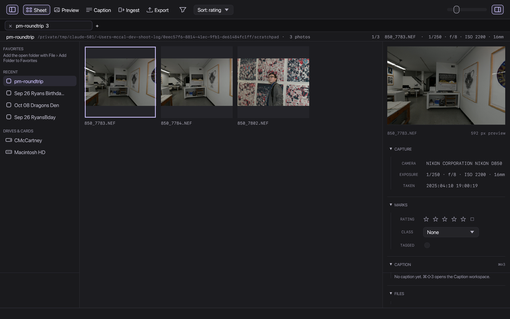
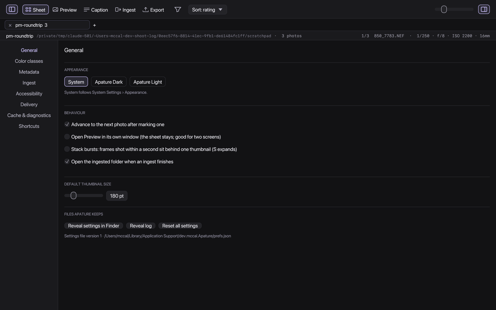

# Apature

Keyboard-first contact sheet, culling, captions, export and delivery for
photojournalists. Rust, macOS first, open source. The ingest → cull →
caption → deliver loop of Photo Mechanic, rebuilt around one rule: the
photographs are the content, the interface is the darkroom.



## What it does

- **Ingest** from a card or any folder: day chips before you copy, a live
  example of every name the templates produce, SHA-256 verification of every
  copy at every destination, a ledger so a card is never copied twice,
  voice-memo and sidecar companions, optional folder preservation, a backup
  destination, eject when verified, and Live Ingest for a watched folder.
- **Cull** on the sheet: ratings, colour classes, tags, filters, sort, tabs,
  burst stacks, compare up to four frames, a loupe, 1:1 with one shared
  magnification, a view-only exposure boost, rotate and crop stored in the
  sidecar and applied on export.
- **Caption** with an assignment pad, code replacements, Photo Mechanic's
  variables, keywords, GPS, recent values, and save-to-selection.
- **Export** JPEG or JPEG XL with presets per outlet, EXIF, XMP and
  IPTC-IIM kept, then **deliver** to a folder, FTP, FTPS or SFTP with
  passwords in the Keychain, retry, and a per-photo sent ledger.
- Two appearances, Reduce Motion, text scaling, higher contrast, focus
  rings, a menu bar extra with live status, toasts, a log file.

| Preview and crop | Caption | Export |
|---|---|---|
|  |  |  |

| Ingest | Settings |
|---|---|
|  |  |

## Install

Download the DMG from the latest release, drag Apature to Applications.
Requires macOS 12 or newer. Optional: `brew install jpeg-xl` for JPEG XL
export.

Or build it yourself (Rust 1.80 or newer):

```bash
scripts/bundle.sh --install   # builds, bundles, ad-hoc signs, installs to /Applications
```

## Keys

Arrows move, Enter or Space opens Preview, Esc returns. `1`–`5` rate,
`0` clears, `⌘1`–`⌘8` set a colour class (or the Photo Mechanic layout in
Settings › Shortcuts), `X` rejects, `T` tags. In Preview: `Z` 1:1, `C`
compare, `L` loupe, `K` crop, `B` brighten, `S` burst stack, `⌘[` `⌘]`
rotate. `⌘⇧1`–`5` switch workspaces, `⌘E` exports, `⌘R` refreshes,
`⌘,` opens Settings. The full table is in Settings › Shortcuts.

## Compatibility promises

- Originals are never modified. Marks, rotation and crop go to the XMP
  sidecar next to the file, edited property by property so what Photo
  Mechanic or Lightroom wrote survives.
- `xmp:Rating`, `xmp:Label`, `photomechanic:ColorClass` and
  `photomechanic:Tagged` are written together, which is what both of those
  need to agree on a label.
- Copies are verified by hash before they count. The card is read-only.

## How it is built

```
crates/
  apature-core/      file model, RAW+JPEG pairing, folder scan, marks, rename/trash
  apature-preview/   embedded-JPEG previews with DCT downscaling, disk cache
  apature-metadata/  EXIF, XMP sidecars edited in place, IPTC-IIM, edits (rotate, crop)
  apature-ingest/    plans, templates with Photo Mechanic variables, verified copy, ledger
  apature-export/    resize, metadata, JPEG and JPEG XL
  apature-deliver/   Folder, FTP, FTPS, SFTP
apps/
  desktop/           egui app
  cli/               apature-cli: scan, ingest, export, deliver, rotate, crop, rename…
docs/                STATUS, DECISIONS, PLAN, design system, research, cross-project
```

Command line examples:

```bash
apature-cli ingest --source /Volumes/CARD --primary /Volumes/SSD --headline Game --day 2026-10-08 --dry-run
apature-cli export --out ./desk --long 2048 --jxl *.NEF
apature-cli deliver --protocol sftp --host desk.example.com --user photo ./desk/*.jpg
```

## Status and plans

[docs/STATUS.md](docs/STATUS.md) says what is implemented, tested and
verified, with numbers. [docs/PLAN.md](docs/PLAN.md) is the handoff and the
order of work. [docs/DECISIONS.md](docs/DECISIONS.md) records every
architectural choice. [CHANGELOG.md](CHANGELOG.md) lists user-visible
changes per release.

## License

MIT OR Apache-2.0, at your option. See [LICENSE-MIT](LICENSE-MIT) and
[LICENSE-APACHE](LICENSE-APACHE). Third-party notices are in
[docs/THIRD_PARTY.md](docs/THIRD_PARTY.md) and in About Apature.
